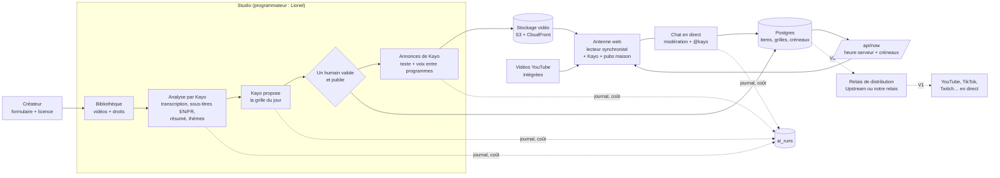

# TAS TV, la plateforme : architecture (V0 du 24/10/2026)

Contexte : prototype construit pendant le DevDay Community Hackathon Paris (rendu dim. 25/10 avant minuit), dans un **dépôt neuf** `tas-tv`. Il prépare la V1 de novembre. Concept repris du deck TAS TV V1 du 14/09 (« Turn it on, don't choose ») : `03_INVESTISSEURS/TAS_TV_2026-09-14/04_SYNTHESE_FR.md`. Recherche sur les plateformes existantes : `01_RECHERCHE_PLATEFORMES_24-7.md`.

## 1. En une phrase

Une chaîne qui tourne 24 h/24 dans le navigateur. Une grille horaire, programmée par des humains avec l'aide de Kayo, fait passer des vidéos de créateurs ; tout le monde voit la même minute au même moment. Kayo regarde chaque vidéo, la sous-titre en anglais et en français, propose la grille du jour et présente la chaîne de sa voix entre les programmes.

## 2. Le schéma

## 2 bis. Ce qu'on reprend des outils qui existent déjà

Upstream, Gyre et LiveReacting font tourner en continu sur YouTube des vidéos déjà enregistrées. On reprend leur structure, mais avec notre propre grille, notre site et Kayo :

| Ce qu'ils font | Chez qui | Chez TAS TV |
|---|---|---|
| Bibliothèque, playlist en boucle dans l'ordre ou au hasard, modifiable pendant le direct | Upstream, Gyre | grille horaire du jour, modifiable, boucle de secours |
| Inserts toutes les N vidéos ou à intervalle fixe : pubs, jingles, stings | Upstream | annonces de Kayo + pubs maison (F-11, F-23) |
| Habillage « now playing » | Upstream (Stream Designer) | carton « À l'antenne » et bandeau « Ensuite » (F-02, F-25) |
| Chat réuni, jeux dans le chat | Upstream (Multichat), LiveReacting | chat du site, modéré, avec Kayo qui répond (F-21, F-22) |
| Envoi vers YouTube, Twitch… sans ordinateur allumé | tous | V1 : relais de distribution (F-24). Piste préférée de Lionel : Upstream (30 $/mois, 24 h gratuites par mois pour essayer, jusqu'à 10 destinations). Notre antenne reste la source ; les réseaux sont des relais. |

Sources consultées le 24/10/2026 : [Upstream, 24/7](https://upstream.so/24-7-live-stream), [Gyre](https://gyre.pro), [comparatif LiveReacting](https://blog.livereacting.com/best-apps-for-24-7-live-streaming/) (un comparatif écrit par un des vendeurs, à lire avec prudence).

## 3. Les choix (et pourquoi)

| # | Choix | Pourquoi | Limite, et ce qui la lève |
|---|---|---|---|
| D1 | **Antenne « virtuelle »** : le serveur publie la grille et l'heure ; chaque lecteur calcule où en est le programme et s'y place. | Aucun serveur de diffusion, coût proche de zéro, marche sur tout navigateur, se construit en un week-end. | Pas d'URL de flux unique pour les applis TV et les distributeurs FAST. V1 : AWS MediaTailor Channel Assembly, formule Basic (0,10 $/h, environ 73 $/mois en 24/7, sur les crédits AWS), à partir de vidéos encodées en HLS au préalable (MediaConvert, environ 225 $ une seule fois pour 100 h). Les vidéos YouTube ne peuvent pas entrer dans ce flux. Mux recommande lui-même l'approche « vidéo calée sur l'heure du serveur » pour un direct simulé. |
| D2 | Deux sources : **fichier hébergé** (contenus TAS ou sous licence) et **vidéo YouTube intégrée** (le créateur garde ses vues, rien n'est téléchargé). | Programmer des créateurs sans copier leurs fichiers. Aucune règle de YouTube trouvée qui interdise de programmer des vidéos en continu (recherche §5). | Rien par-dessus le lecteur YouTube : l'habillage TAS se place à côté. Un seul lecteur YouTube actif, donc pas de préchargement caché. Pas de publicité vendue autour. Intégration seulement si le créateur a dit oui. |
| D3 | **Kayo propose, un humain publie.** L'IA ne publie jamais une grille seule. | La curation humaine est la promesse de TAS TV ; c'est aussi la règle déjà posée pour TASK. | — |
| D4 | Pile : Next.js 16 + TypeScript, Postgres, stockage S3, API OpenAI, déploiement Vercel. | Même pile que le site et TASK ; crédits AWS (1 120 $) pour la vidéo. | — |
| D5 | Heures stockées en UTC, affichées à l'heure de Paris ; une grille par jour. | Pas d'ambiguïté au changement d'heure (le 25/10 à 3 h, justement). | — |
| D6 | Pas de chevauchement de créneaux, **garanti par la base** (contrainte d'exclusion Postgres). | Une règle dans la base ne s'oublie pas dans le code. | — |
| D7 | Un seul compte programmateur (mot de passe en variable d'environnement). | Prototype à un opérateur. | V1 : vrais comptes et rôles. |
| D8 | L'analyse des vidéos tourne **depuis le Mac** (`pnpm ingest`) pour le prototype. | Extraire l'audio d'une vidéo longue dépasse ce qu'une fonction Vercel fait bien. | V1 : une file de tâches. |
| D9 | **Chat** : messages en base, lus par le navigateur toutes les 2 s. | Pas de serveur temps réel à installer. Largement suffisant pour quelques centaines de spectateurs. | Au-delà : un service temps réel (WebSocket). |
| D10 | **Les réseaux sont des relais, pas la source.** L'antenne TAS TV fait foi. En V1, la même grille part en direct vers YouTube, TikTok et les autres réseaux, via Upstream (choix préféré de Lionel) ou via notre propre relais (ffmpeg, qui suit la grille et envoie en RTMP). | TAS TV garde son public, ses données et son habillage ; les réseaux apportent la portée. | À trancher en V1 : Upstream rejoue sa propre playlist, donc il faut lui envoyer nos fichiers dans l'ordre de la grille, ou vérifier s'il accepte un flux entrant. Les annonces et les pubs doivent devenir de petites vidéos. YouTube scanne le direct (Content ID) et ne garde pas l'archive d'un direct de plus de 12 h. |

## 4. Les briques

- **Antenne** (`/`) :
  - le lecteur plein écran, le bouton « Allumer TAS TV » (un clic est nécessaire pour avoir le son) ;
  - les bandeaux « À l'antenne » et « Ensuite », le crédit et le lien vers la chaîne du créateur ;
  - les sous-titres EN ou FR.
- **Grille** (`/grille`) : le programme du jour et du lendemain.
- **Proposer** (`/proposer`) : le formulaire du créateur (lien, présentation, acceptation de la licence de diffusion non exclusive).
- **Studio** (`/studio`, protégé) :
  - la bibliothèque ;
  - le statut des droits ;
  - le lancement de l'analyse ;
  - l'éditeur de grille ;
  - « Kayo, propose la journée » ;
  - la publication.
- **API** :
  - `GET /api/now` : l'heure du serveur, le créneau en cours et les suivants ;
  - `GET /api/grid?day=` ;
  - routes du studio : items, analyse, proposition, publication, soumissions.
- **Base** :
  - `creators`, `items`, `grids`, `slots`, `submissions` ;
  - `ai_runs` : le journal de chaque appel IA (modèle, jetons, coût estimé, version du prompt).
- **Stockage** : vidéos, sous-titres (WebVTT) et voix de Kayo sur S3, servis par CloudFront. En local, un dossier `media/`.

## 5. Comment l'antenne reste synchronisée

1. Le lecteur appelle `/api/now`. Il reçoit l'heure du serveur et les créneaux en cours et à venir (début, fin, source).
2. Il calcule `décalage = heure serveur corrigée − début du créneau`, charge la source et se place à ce décalage :
   - fichier : `currentTime` ;
   - YouTube : `startSeconds`.
3. À la fin du créneau, il passe au suivant, déjà préchargé. Toutes les 60 s, il se recale s'il a dérivé de plus de 2 s.
4. Si un créneau est vide, la chaîne passe une boucle de secours (des clips TAS calculés sur l'heure), ce qui évite un écran noir.

## 6. Ce que fait l'API d'OpenAI (à nommer dans le pitch)

| Étape | Outil OpenAI | Sortie |
|---|---|---|
| Kayo « regarde » une vidéo | Speech-to-text (transcription) | texte horodaté → sous-titres WebVTT |
| Traduire et décrire | Responses API + Structured Outputs | sous-titres FR ou EN, résumé, thèmes, ambiance, public |
| Programmer la journée | Responses API + Structured Outputs | grille proposée, avec une raison par créneau |
| Présenter la chaîne | Responses API (texte) + Text-to-speech (voix) | annonces de 10 à 15 s entre les programmes |
| Filtrer le chat et les soumissions | Moderation | message bloqué ou signalé au programmateur |
| Répondre dans le chat (« @kayo ») | Responses API | réponse courte, fondée sur la fiche du programme en cours |

Les noms exacts des modèles sont lus dans la documentation officielle au moment du build et passés par variables d'environnement (`OPENAI_MODEL`, `OPENAI_STT_MODEL`, `OPENAI_TTS_MODEL`). Un budget mensuel coupe les appels au-delà du plafond.

## 7. Du prototype à la V1 (novembre)

| | Prototype (25/10) | V1 (novembre) |
|---|---|---|
| Diffusion | antenne web synchronisée (notre version, en local ou en ligne) | + relais en direct vers YouTube, TikTok, Twitch (Upstream ou notre relais) + flux HLS unique (applis TV, distributeurs FAST) |
| Contenus | catalogue TAS + quelques créateurs consentants | registre des droits, contrats créateurs (modèle à faire valider) |
| Analyse | script lancé depuis le Mac | file de tâches dans le cloud |
| Comptes | un programmateur | programmateurs, créateurs, spectateurs inscrits (rappels) |
| Mesure | aucune ou presque | spectateurs, durée, retour à J+7 (seuils du deck) |
| Revenus | aucun | créneaux sponsorisés (hypothèse du deck) |
